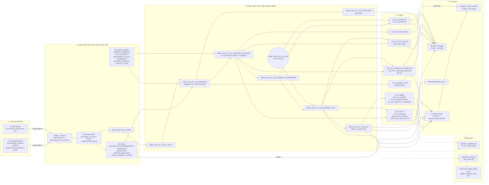

# FINMA LCR Reporting & Liquidity Analytics - Business Requirements

Single specification for the Liquidity Risk (LCR) domain: business rules, requirements, implementation coverage and test plan.
It merges the original FINMA LCR requirements with the extended E2E cashflow & liquidity analytics showcase spec ("Steini" showcase, requirement IDs `REQ-*`, test cases `TC-VAL-*`).

- **Regulatory basis:** FINMA Circular 2015/2 "Liquidity risks - banks", Liquidity Ordinance (LiqV) Art. 14-20, Basel III LCR framework.
- **Scope:** Swiss synthetic regional bank, reporting currency **CHF**, DEV database `AAA_DEV_SYNTHETIC_BANK` (raw `REP_RAW_V001.LIQI_*`, engine `REP_AGG_V001.REPP_AGG_*`).
- **Related:** [LCR_DATA_DICTIONARY.md](LCR_DATA_DICTIONARY.md) (snapshot of object and column descriptions), runbook in the repository [README](../README.md#lcr-showcase-runbook-finma-chf).
- **Status (2026-10-25):** deployed via DCM on DEV, verified by a full from-scratch rebuild (`operation/full_rebuild_test.sh`, all suites PASS). Latest regulatory LCR 133.15% (PASS); 7 of 90 days below 100% in the stress window; COMBINED stress low 67.4%.

---

## 0. Data Flow



**Single calculation path:** every LCR number (reported, stress, attribution, simulator) comes from `REPP_AGG_DT_LCR_SCENARIO_COMPONENTS` and the shared function `REPP_AGG_FN_LCR_CALC`, so the paths always reconcile.
**Refresh:** the load tasks run when their stream has new files; the dynamic tables refresh with a 60-minute target lag (`operation/execute_all_tasks_and_refresh_dts.sql` forces both).
**Deployment:** all objects are DCM `DEFINE` statements (`060_LIQI_ingestion.sql`, `359`-`363_LIQA_*.sql`, `715_LCRS_semantic_views.sql`); rule-table seeds and the agent come from `post_deploy.sql`.

---

## 1. Business Objectives

1. **Regulatory compliance:** daily regulatory LCR, monthly internal and quarterly SNB reporting (survey LCR_P).
2. **Risk management:** daily monitoring against the 100% minimum and the 110% internal target.
3. **Stress testing:** regulatory LCR plus internal bank, market and combined stress scenarios side by side.
4. **Root cause analysis:** explain every LCR movement down to the client and contract that drove it.
5. **What-if decisions:** simulate withdrawals, funding and asset moves before they happen.
6. **Audit trail:** data lineage, data quality quarantine and full object/column metadata.

**Stakeholders:** Treasury (daily liquidity, funding), Risk Management (stress testing, oversight), Finance (board and SNB reporting), Audit & Compliance, Executive Management.

## 2. Regulatory Context

| Requirement | Specification |
|---|---|
| Minimum LCR | 100% (30-day stress horizon) |
| Internal target | 110% |
| Reporting frequency | Daily (internal), monthly (board), quarterly (SNB LCR_P) |
| Data timeliness | T+1 (daily close-of-business cut-off) |
| Accuracy | < 1% error tolerance; every LCR path must reconcile to the shared calculation |

## 3. Business Logic

### 3.1 LCR formula and status bands

```
LCR = HQLA after haircuts and caps / (Outflows - min(Inflows, 75% x Outflows)) x 100%
```

| Status | LCR | Action |
|---|---|---|
| **PASS** | >= 110% | None |
| **WARNING** | 100% - 110% | Below internal target; Treasury action plan |
| **FAIL** | < 100% | Regulatory breach; report to FINMA |

### 3.2 HQLA (numerator)

| Level | Haircut | Eligible assets |
|---|---|---|
| **Level 1** | 0% | SNB reserves, vault cash, Swiss Confederation bonds, foreign government bonds rated AA- or better |
| **Level 2A** | 15% | Canton bonds, covered bonds / Pfandbriefe, corporate bonds rated AA- or better |
| **Level 2B** | 50% | Corporate bonds rated A+ to BBB-, SMI equities |

**Caps (FINMA):**
- Level 2B after haircut <= 15/85 x (Level 1 + Level 2A).
- Level 2 in total after haircut <= 2/3 x Level 1 (= 40% of HQLA).
- Excess is removed from Level 2B first, then Level 2A.

**Exclusions:** non-SMI equities, structured products, derivatives, securitisations, corporate bonds below BBB-. Unknown products are quarantined, not calculated (see 3.6).

### 3.3 Outflows and inflows (denominator)

Outflow = balance x run-off rate. Regulatory (BASE) run-off rates:

| Segment | Run-off |
|---|---|
| Retail - stable, insured (<= CHF 100K) | 3% |
| Retail - stable | 5% |
| Retail - less stable | 10% |
| Corporate - operational | 25% |
| Corporate - non-operational | 40% |
| Financial institutions, unsecured wholesale, interbank borrowing | 100% |

**Relationship adjustments (retail):** -2% for 3+ active products, -1% for a direct debit mandate, +5% for tenure under 18 months.

**Committed facilities (undrawn amount):** drawdown 5% for retail credit facilities, 10% for corporate and SME credit facilities, 30% for corporate liquidity facilities, 40% for liquidity facilities to financial institutions.

**Inflows:** performing contractual inflows within 30 days at 50% (retail, corporate and SME loans) or 100% (interbank loans); total inflows are capped at 75% of outflows.

### 3.4 Stress scenarios

| Scenario | Meaning |
|---|---|
| `BASE` | Regulatory FINMA LCR (reported figure) |
| `BANK_STRESS` | Bank-specific stress: higher retail and corporate run-off, more facility drawdowns, lower inflows |
| `MARKET_STRESS` | Systemic stress: additional HQLA haircuts, moderate run-off increase, lower inflows |
| `COMBINED` | Idiosyncratic and market-wide stress together |

Stress scenarios are internal; they never show a better LCR than BASE. All rates live in a behavioral rules table per product type, counterparty sector and scenario, so a rule change needs no code change.

### 3.5 Maturity ladder and behavioral modeling

- Contractual cashflows are bucketed into overnight (`ON`), 2-7 days (`D2_7`), 8-30 days (`D8_30`), 1-3 months (`M1_3`), 3-6 months (`M3_6`), 6-12 months (`M6_12`) and over 1 year (`Y1P`).
- Non-maturity deposits run down linearly over a decay profile (days per product type).
- The cumulative liquidity gap per bucket is reported next to the LCR.

### 3.6 Data quality

Records are quarantined into an exceptions table instead of stopping the pipeline:

| Code | Rule |
|---|---|
| `UNMAPPED_ASSET_CLASS` | Product code has no asset class mapping |
| `MISSING_FX` | No end-of-day rate for the currency and date |
| `INVALID_DATE` | Maturity before the cut-off date or not parsable |
| `MISSING_RULE` | No behavioral rule for product type, sector and scenario |

FX: one end-of-day rate per currency and calendar day, converted to CHF with an equality join (no as-of lookup).

### 3.7 Variance attribution (root cause)

For a change between two cut-offs (T vs. T-1, T-7 or T-30), each position's contribution is exact:

```
dLCR(position) = dW/N1 - H0 x dO/(N0 x N1) + H0 x dI/(N0 x N1)
```

W = weighted HQLA, O = outflows, I = capped inflows, H0 and N0 = HQLA and net outflows at the earlier date, N1 = net outflows at the later date.
Two adjustment lines (`CAP_ADJUSTMENT`, `INFLOW_CAP_ADJUSTMENT`) capture the effect of the caps, so contributions sum exactly to the LCR change.

**Client impact** = contribution + settlement impact (a withdrawn deposit also reduces SNB cash). The top 10 drivers are ranked by client impact.

### 3.8 What-if simulation

Levers are applied to a cut-off date and recomputed with the same shared calculation:
- Levers: an additional deposit withdrawal (CHF), run-off multipliers per segment (retail stable, retail less stable, corporate operational, corporate non-operational, financial institutions), facility drawdown and inflow multipliers, the inflow cap and an HQLA price shock.
- Output: a waterfall from the reported LCR to the simulated LCR, plus the breakeven withdrawal that brings the LCR to 100%.

## 4. Requirements and Coverage

Status: **FULL**, **PARTIAL**, **ADAPTED** (met with a deliberate change, see section 6), **OUT OF SCOPE**.

| ID | Requirement | Status | Implemented by |
|---|---|---|---|
| REQ-ING-01 | Load raw transactions and counterparty master data | FULL | `LIQI_RAW_TB_COUNTERPARTIES`, `LIQI_RAW_TB_CONTRACTS`, `LIQI_RAW_TB_DEPOSIT_BALANCES`, `LIQI_RAW_TB_HQLA_HOLDINGS`; stages + serverless load tasks (`060_LIQI_ingestion.sql`) |
| REQ-ING-02 | Daily cashflow updates with as-of partitioning | FULL (demo scale) | `LIQI_RAW_TB_CASHFLOWS` (AS_OF_DATE x CONTRACT_ID x CF_DATE x CF_TYPE), clustered by AS_OF_DATE |
| REQ-ING-03 | Daily FX rates at cut-off | ADAPTED (CHF) | `generators/fx_generator.py`, `REPP_AGG_DT_LCR_FX_DAILY`; missing rate -> `MISSING_FX` |
| REQ-DQ-01 | Quarantine unmapped products, invalid dates, missing FX | FULL | `REPP_AGG_DT_LCR_POSITIONS` -> `REPP_AGG_DT_LCR_EXCEPTIONS`; app tab *Data Quality* |
| REQ-MAP-01 | Asset class taxonomy L1 / L2A / L2B / Non-HQLA | FULL | `LIQI_RAW_TB_PRODUCT_MAPPING`, `LIQI_RAW_TB_HQLA_ELIGIBILITY` |
| REQ-ENG-01 | Contractual cashflows by maturity bucket | FULL | `LIQI_RAW_TB_MATURITY_BUCKETS`, `REPP_AGG_DT_LCR_LIQUIDITY_GAP`; app tab *Behavioral* |
| REQ-ENG-02 | Behavioral rules for non-maturity products | FULL | `LIQI_RAW_TB_BEHAVIORAL_RULES` (decay profiles, facility drawdowns) |
| REQ-ENG-03 | Run-off rates and inflow caps per asset class and sector | FULL | `REPP_AGG_DT_LCR_SCENARIO_POSITIONS`, `REPP_AGG_FN_LCR_CALC`; app tab *Flows & Inflow Cap* |
| REQ-ENG-04 | HQLA buffer with haircuts | ADAPTED (FINMA) | `REPP_AGG_DT_LCR_SCENARIO_COMPONENTS`, `REPP_AGG_FN_LCR_CALC`; app tab *HQLA & Caps* |
| REQ-ENG-05 | Simultaneous stress scenarios | FULL | `LIQI_RAW_TB_SCENARIOS`, `REPP_AGG_DT_LCR_SCENARIO_DAILY`; `REPP_AGG_SP_LCR_SIMULATE`, `REPP_AGG_SP_LCR_WHAT_IF` |
| REQ-ANL-01 | DoD / WoW / MoM cut-off deltas | FULL | `REPP_AGG_DT_LCR_CUTOFF_DELTAS`; app tab *Variance* |
| REQ-ANL-02 | Drill-down gap -> asset class -> product group -> counterparty -> contract | FULL | `REPP_AGG_VW_LCR_DRILLDOWN`; app tab *Drill-down* |
| REQ-UI-01 | Dashboard to compare cut-offs and visualise gaps | FULL | `the_bank_app/pages/lcr_monitoring.py` (11 tabs, date slider, event markers) |
| REQ-UI-02 | Filters: business unit, asset class, currency, rating, scenario | PARTIAL | Scenario, business unit, asset class, date; currency as a tab; **no rating filter** |
| REQ-UI-03 | Root cause analyzer: top 10 contracts driving daily variance | FULL | `REPP_AGG_VW_LCR_VARIANCE_ATTRIBUTION`, `REPP_AGG_VW_LCR_VARIANCE_DRIVERS`; agent tool `LCR_Variance_Drivers` |
| REQ-PER-01 | Sub-second summaries, < 3 s drill-down | PARTIAL | Pre-aggregated dynamic tables; not measured at multi-million rows |

**Beyond the requirements:**
- Events table `LIQI_RAW_TB_EVENTS` with five showcase events (withdrawal, market stress, recovery, inflows).
- Semantic views `LCRS_SV_LCR_SCENARIOS`, `LCRS_SV_LCR_DRIVERS`, `LCRS_SV_LCR_EVENTS`; all 8 LCR semantic views have verified queries (18 VQRs).
- `LIQUIDITY_RISK_AGENT` what-if tool, routed by the master agent.
- Metadata gate: every LCR object and column has a description.

## 5. Test Plan

Engine tests: `sqlunit/lcr_validation.sql` (11 test queries, 16 result rows), run by the `deploy.sh` test gate together with `sqlunit/metadata_check.sql` and `sqlunit/data_check.sql` (21 checks in total).

| Case | Status | Coverage |
|---|---|---|
| TC-VAL-01 Reconciliation vs. legacy system (ANUBIS) | OUT OF SCOPE (no legacy system) | Substitute: every LCR path reconciles to `REPP_AGG_FN_LCR_CALC` (`TC-VAL-01 haircuts`, `TC-VAL-02 caps + formula`, `ENG-02`, `ENG-05`) |
| TC-VAL-02 Drill-down speed over 240M cashflow rows | OUT OF SCOPE (skipped) | Functional drill-down covered by `the_bank_app/tests/test_lcr_page.py`; no volume test |
| TC-VAL-03 Unknown product code quarantined | FULL | Generator injects bad records; `TC-VAL-03 exceptions` |
| TC-VAL-04 CHF 50M withdrawal identified as root cause | FULL | Event `EVT_01`; `TC-VAL-04a` (direction and size), `TC-VAL-04b` (event client is the #1 driver) |

Engine regression checks: `ENG-01` attribution sums to the LCR change, `ENG-03` stress <= BASE, `ENG-04` showcase shape (FAIL days exist, latest day not failing), `ENG-06` breakeven brings the LCR to ~100%.
App tests: `the_bank_app/tests/test_lcr_page.py`, `the_bank_app/tests/test_all_pages.py`.
Semantic layer: `sqlunit/run_semantic_view_vqrs.py` runs all verified queries (54 across 19 semantic views, 18 of them on the LCR views); `sqlunit/agent_smoke_test.py` asks `LIQUIDITY_RISK_AGENT` for the current LCR; golden regression cases 1, 2 and 13-15 cover the LCR, the HQLA buffer, root cause, what-if and stress.
Full regression: `operation/full_rebuild_test.sh DEV --yes` drops and rebuilds the database and runs all of the above (last PASS 2026-10-25).

| Check (2026-10-25) | Result |
|---|---|
| Test gate (TC-VAL, ENG, META, DATA) | 21/21 PASS |
| Verified queries | 54/54 PASS |
| Agent smoke test | 8/8 PASS |
| Golden regression (FULL) | 15/15 PASS |
| App tests | ALL PASS |

## 6. Deviations from the Showcase Spec

| Spec | Implementation | Reason |
|---|---|---|
| EUR base currency | CHF base currency, FINMA LCR | Swiss synthetic bank |
| Medallion schemas `RAW_SPOT` / `SILVER_LIQUIDITY` / `GOLD_LIQUIDITY` | `REP_RAW_V001` (`LIQI_*`), `REP_AGG_V001` (`REPP_AGG_*`) | Repository naming convention |
| 50M-240M cashflows per day from a mainframe CDC feed | Demo scale: ~CHF 0.7bn HQLA, 90 daily cut-offs, generated files | Showcase; volume test skipped |
| Haircut example "15% covered bonds, 25-50% corporates" | FINMA levels and caps (section 3.2) | Regulatory rules |
| FX as-of join | One end-of-day rate per calendar day, equality join | Simpler and exact |

## 7. Open Points

1. REQ-UI-02: add rating and currency filters to the drill-down.
2. REQ-PER-01 / TC-VAL-02: performance proof at 50-100M rows.
3. TC-VAL-01: reconciliation needs a legacy reference extract.
4. Intraday LCR, NSFR module and LCR forecasting (roadmap).
5. On a brand-new database the load tasks run only after `upload-data.sh`, so the LCR is empty until `execute_all_tasks_and_refresh_dts.sql` (or the next scheduled run and refresh) has run.

## 8. Regulatory References

1. FINMA Circular 2015/2 "Liquidity risks - banks": https://www.finma.ch/en/documentation/circulars/
2. Liquidity Ordinance (LiqV), Art. 14-20: https://www.fedlex.admin.ch
3. Basel III LCR framework (BCBS d295): https://www.bis.org/bcbs/publ/d295.htm
4. SNB survey LCR_P: https://data.snb.ch/en/surveys
